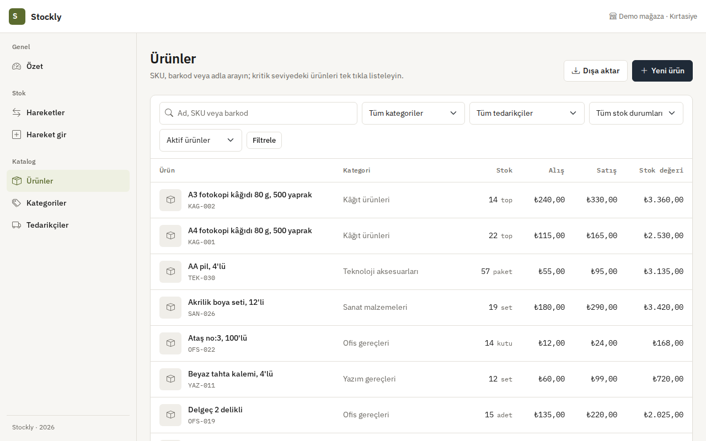
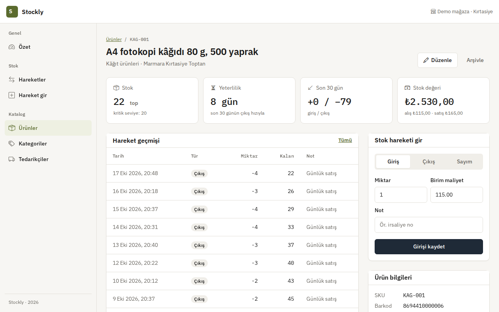
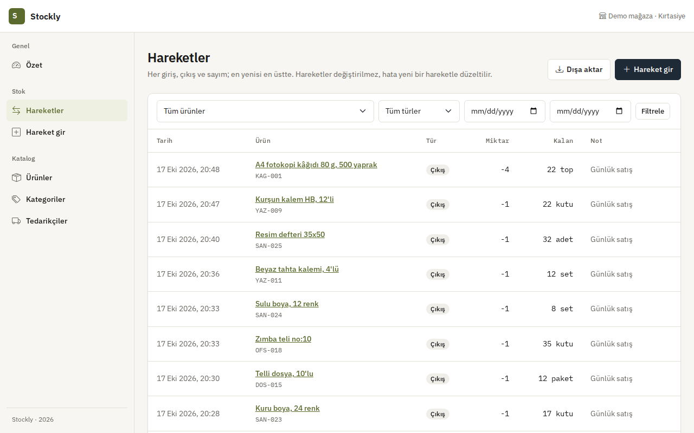
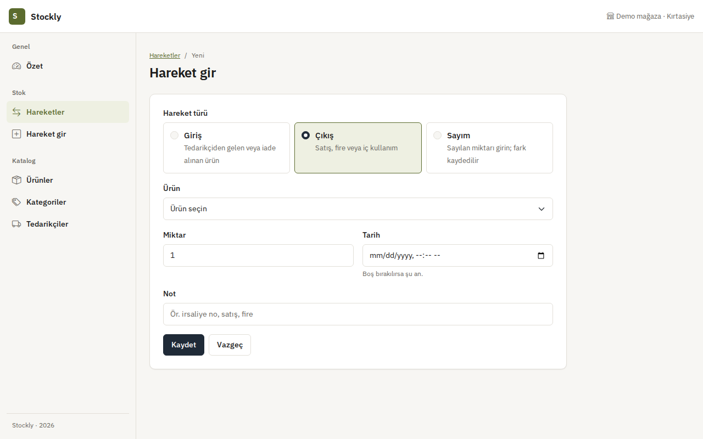
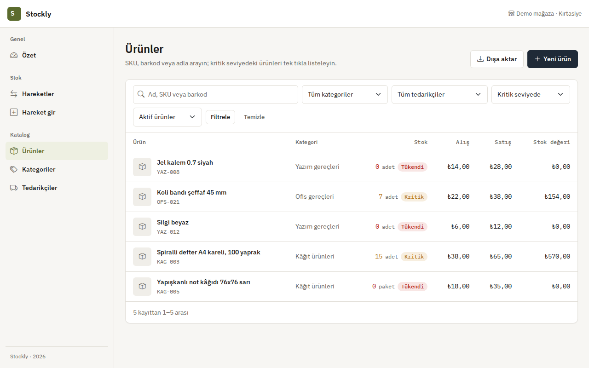
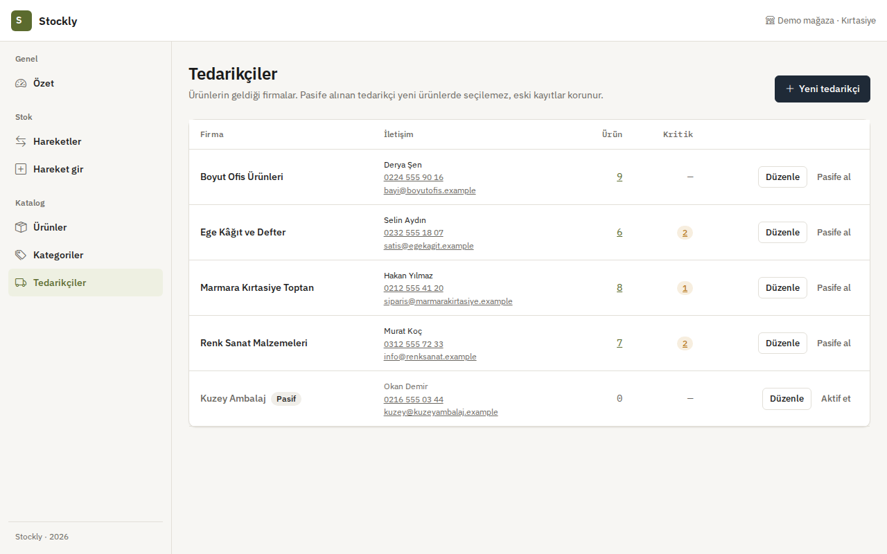
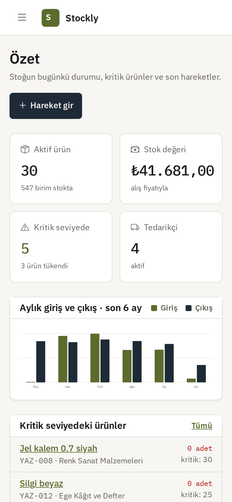
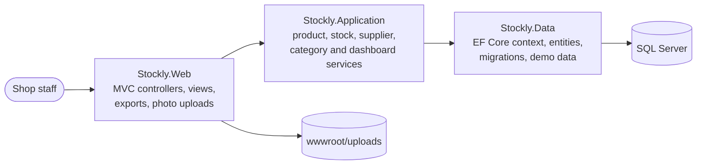

# Stockly

**English** · [Türkçe](README.tr.md)

Stock management for a small shop: products with SKU and barcode, goods in and out, stock counts, critical-level alerts, suppliers, a dashboard and Excel/CSV exports.

[](https://github.com/Beratoguzhan620/stockly/actions/workflows/ci.yml)


## Try it

```bash
docker compose up --build
```

Open http://localhost:8080. The demo data is a stationery shop: thirty products in six categories, five suppliers and about six months of stock movements. A few products sit at their critical level on purpose. There is no sign-in: the app is meant for a single shop.

## Features

- **Products:**
  - SKU (unique, upper-cased) and optional barcode (unique). EAN-13 check digits are verified, so a misread barcode is caught.
  - Unit, purchase and sale price, critical level, supplier and photo.
  - Products are archived rather than deleted, so their history stays.
- **Stock movements:**
  - **Goods in** with unit cost, and **goods out**, which never go below zero.
  - **Count:** enter the counted quantity; the difference is recorded as its own movement.
  - Movements are never edited; a mistake is fixed with a new movement.
- **Critical stock:** a warning right after a movement, a critical/out-of-stock filter, and counts per category and supplier.
- **Product page:**
  - Days of cover at the last 30 days' pace and in/out totals.
  - Stock value and the full history.
  - In/out/count forms on the same page.
- **Dashboard:**
  - Active products and stock value.
  - Critical and out-of-stock items, active suppliers.
  - Six-month in/out chart (dependency-free SVG) and the latest movements.
- **Lists:** search by name, SKU or barcode; filters; paging.
- **Exports:** Excel (.xlsx) and CSV of the filtered products or movements, all pages. CSV is written for Turkish Excel (UTF-8 BOM, semicolons), and formula-like cells are neutralised.
- **Suppliers:** contact details, product and critical counts, pausing a supplier without losing its products.

## Screenshots

| Products | Product page |
|---|---|
|  |  |
| **Movements** | **Stock entry** |
|  |  |
| **Critical products** | **Suppliers** |
|  |  |

<p align="center"></p>

## How stock stays correct

- **Single source:** the quantity on hand lives on the product, and every change goes through `StockService`, which writes the movement and the new quantity in one transaction.
- **No negative stock:** the update is a single conditional SQL statement (`… SET StockQuantity = StockQuantity + @delta WHERE StockQuantity + @delta >= 0`). Two people taking the last item at the same time cannot push it below zero.
- **Safe counts:** a count only applies if nobody changed the stock since the form was opened.
- **Database checks:** constraints refuse negative stock, negative balances and negative prices even if a bug slipped through.
- **History:** each movement stores the balance after it, so the history reads like a bank statement.

## Tech stack

- ASP.NET Core MVC on .NET 10, Razor views, Bootstrap 5 with a small design system ([docs/DESIGN.md](docs/DESIGN.md))
- Entity Framework Core 10 with SQL Server and migrations
- xUnit with in-memory SQLite for service tests, Playwright for UI checks
- GitHub Actions: build with warnings as errors, tests, pending-migration check, Docker Compose smoke test and a UI preview on every pull request
- Docker / Docker Compose

## Architecture



## Running without Docker

Requirements: .NET 10 SDK and SQL Server LocalDB (or set `ConnectionStrings__DefaultConnection`).

```bash
dotnet run --project src/Stockly.Web --launch-profile https
```

Migrations run on start-up; the Development settings turn on the demo data. Other settings: `Seed__DemoContent` and `DataProtection__KeysPath`.

## Tests

```bash
dotnet test
```

The tests use an in-memory SQLite database built from the real model. They cover:

- **Stock:** goods in and out, the last item, refusing negative stock, counts, invalid quantities, future dates, archived products, critical alerts, movement filters.
- **Products:** SKU and barcode rules (EAN-13 included), opening stock, edits that must not touch stock, filters and paging, days of cover.
- **Categories and suppliers:** duplicate names regardless of case and spacing, blocking the delete of a category in use.
- **Exports:** CSV quoting and formula neutralising; the .xlsx package and typed cells.
- **Demo data:** every product's stock equals its movement history.

The UI preview workflow walks through the main flows with Playwright at desktop and 360 px widths, downloads both export formats and fails if a page scrolls sideways.

## Roadmap and known gaps

- Sign-in and roles (one shop, one team today).
- Purchase orders that turn into goods-in when delivered.
- A barcode-scanner friendly quick entry page.

## Background

This project started as a bootcamp project and was later rebuilt from the ground up. It used to be a one-page category list; what changed:

- **Scope:** turned into a stock management app with products, suppliers and stock movements.
- **Design:** a consistent interface on a small design system, usable on phones.
- **Code:** a service layer, transactional stock updates, migrations instead of `EnsureCreated`, a committed connection string removed.
- **Tests and CI:** service tests on SQLite, a Docker Compose smoke test and automated UI screenshots on every pull request.

## License

[MIT](LICENSE) · Berat Oğuzhan Turğut · [GitHub](https://github.com/Beratoguzhan620)
