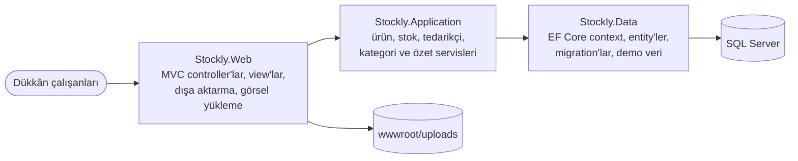

# Stockly

[English](README.md) · **Türkçe**

Küçük bir dükkân için stok yönetimi: SKU ve barkodlu ürünler, giriş-çıkış, sayım, kritik seviye uyarıları, tedarikçiler, özet ekranı ve Excel/CSV dışa aktarma.

[](https://github.com/Beratoguzhan620/stockly/actions/workflows/ci.yml)


## Deneyin

```bash
docker compose up --build
```

http://localhost:8080 adresini açın. Demo veri bir kırtasiye dükkânı: altı kategoride otuz ürün, beş tedarikçi ve yaklaşık altı aylık stok hareketi. Birkaç ürün bilerek kritik seviyede. Giriş ekranı yok; uygulama tek bir dükkân için tasarlandı.

## Özellikler

- **Ürünler:**
  - SKU (benzersiz, büyük harfe çevrilir) ve isteğe bağlı barkod (benzersiz). EAN-13 kontrol hanesi doğrulanır, yanlış okutulan barkod yakalanır.
  - Birim, alış ve satış fiyatı, kritik seviye, tedarikçi ve görsel.
  - Ürünler silinmez, arşivlenir; geçmiş korunur.
- **Stok hareketleri:**
  - Birim maliyetli **giriş** ve **çıkış**; çıkış stoğu asla sıfırın altına düşürmez.
  - **Sayım:** sayılan miktar girilir, fark ayrı bir hareket olarak kaydedilir.
  - Hareketler düzenlenmez; hata yeni bir hareketle düzeltilir.
- **Kritik stok:** hareketin hemen ardından uyarı, kritik/tükenen filtresi, kategori ve tedarikçi bazında sayılar.
- **Ürün sayfası:**
  - Son 30 günün hızıyla stoğun kaç gün yeteceği ve giriş/çıkış toplamları.
  - Stok değeri ve tüm geçmiş.
  - Aynı sayfada giriş/çıkış/sayım formları.
- **Özet ekranı:**
  - Aktif ürün ve stok değeri.
  - Kritik ve tükenen ürünler, aktif tedarikçiler.
  - Altı aylık giriş/çıkış grafiği (bağımlılıksız SVG) ve son hareketler.
- **Listeler:** ad, SKU veya barkodla arama; filtreler; sayfalama.
- **Dışa aktarma:** filtrelenmiş ürünlerin veya hareketlerin tamamı Excel (.xlsx) ya da CSV olarak indirilir. CSV, Türkçe Excel için yazılır (UTF-8 BOM, noktalı virgül); formül gibi görünen hücreler etkisizleştirilir.
- **Tedarikçiler:** iletişim bilgileri, ürün ve kritik ürün sayıları, ürünleri kaybetmeden pasife alma.

## Ekran görüntüleri

| Ürünler | Ürün sayfası |
|---|---|
|  |  |
| **Hareketler** | **Hareket girişi** |
|  |  |
| **Kritik ürünler** | **Tedarikçiler** |
|  |  |

<p align="center"></p>

## Stok nasıl doğru kalıyor?

- **Tek kaynak:** eldeki miktar üründe tutulur ve her değişiklik `StockService` üzerinden geçer; hareket ve yeni miktar aynı transaction'da yazılır.
- **Eksi stok yok:** güncelleme tek bir koşullu SQL komutudur (`… SET StockQuantity = StockQuantity + @delta WHERE StockQuantity + @delta >= 0`). Son ürünü aynı anda alan iki kişi stoğu eksiye düşüremez.
- **Güvenli sayım:** sayım, form açıldığından beri stok değişmediyse uygulanır.
- **Veritabanı kontrolleri:** bir hata gözden kaçsa bile kısıtlar eksi stoğu, eksi bakiyeyi ve eksi fiyatı reddeder.
- **Geçmiş:** her hareket kendisinden sonraki bakiyeyi saklar; geçmiş bir hesap dökümü gibi okunur.

## Teknolojiler

- .NET 10 üzerinde ASP.NET Core MVC, Razor view'lar, küçük bir tasarım sistemiyle Bootstrap 5 ([docs/DESIGN.md](docs/DESIGN.md))
- Entity Framework Core 10 + SQL Server ve migration'lar
- Servis testleri için xUnit + bellek içi SQLite, arayüz kontrolleri için Playwright
- GitHub Actions: her pull request'te uyarıların hata sayıldığı build, testler, eksik migration kontrolü, Docker Compose duman testi ve arayüz önizlemesi
- Docker / Docker Compose

## Mimari



## Docker olmadan çalıştırma

Gerekenler: .NET 10 SDK ve SQL Server LocalDB (ya da `ConnectionStrings__DefaultConnection` ayarı).

```bash
dotnet run --project src/Stockly.Web --launch-profile https
```

Migration'lar açılışta uygulanır; Development ayarları demo veriyi açar. Diğer ayarlar: `Seed__DemoContent` ve `DataProtection__KeysPath`.

## Testler

```bash
dotnet test
```

Testler gerçek modelden kurulan bellek içi SQLite veritabanında çalışır. Kapsadıkları:

- **Stok:** giriş ve çıkış, son ürün, eksi stoğun reddi, sayım, geçersiz miktarlar, gelecek tarih, arşivli ürün, kritik uyarı, hareket filtreleri.
- **Ürünler:** SKU ve barkod kuralları (EAN-13 dahil), açılış stoğu, stoğa dokunmaması gereken düzenlemeler, filtreler ve sayfalama, yeterlilik süresi.
- **Kategoriler ve tedarikçiler:** büyük-küçük harf ve boşluktan bağımsız mükerrer ad kontrolü, kullanılan kategorinin silinmesinin engellenmesi.
- **Dışa aktarma:** CSV tırnaklama ve formül etkisizleştirme; .xlsx paketi ve hücre tipleri.
- **Demo veri:** her ürünün stoğu hareket geçmişiyle aynı.

UI preview iş akışı ana akışları Playwright ile masaüstü ve 360 px genişlikte dolaşır, iki dışa aktarma biçimini de indirir ve yatay kaydırma olan sayfada hata verir.

## Yol haritası ve bilinen eksikler

- Giriş ve roller (bugün tek dükkân, tek ekip).
- Teslim alınınca girişe dönüşen satın alma siparişleri.
- Barkod okuyucuyla hızlı giriş sayfası.

## Proje geçmişi

Bu proje bir bootcamp projesi olarak başladı, sonra baştan geliştirildi. Başlangıçta tek sayfalık bir kategori listesiydi; neler değişti:

- **Kapsam:** ürünler, tedarikçiler ve stok hareketleriyle bir stok yönetimi uygulamasına dönüştü.
- **Tasarım:** küçük bir tasarım sistemine dayanan, telefonda da rahat kullanılan tutarlı bir arayüz.
- **Kod:** servis katmanı, transaction'lı stok güncellemesi, `EnsureCreated` yerine migration'lar, repoya girmiş bağlantı cümlesinin kaldırılması.
- **Test ve CI:** SQLite üzerinde servis testleri, Docker Compose duman testi ve her pull request'te otomatik arayüz görüntüleri.

## Lisans

[MIT](LICENSE) · Berat Oğuzhan Turğut · [GitHub](https://github.com/Beratoguzhan620)
